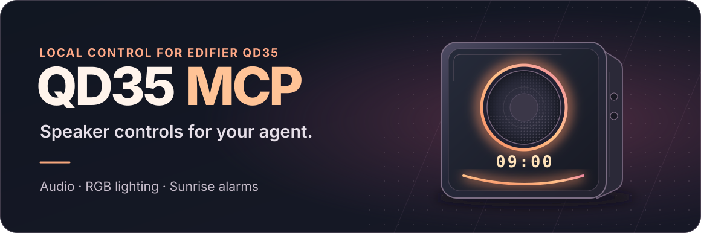

# QD35 MCP



[](https://github.com/pauljones0/qd35-mcp/actions/workflows/ci.yml)
[](LICENSE)

Control an **Edifier QD35** from an MCP client on Linux. The server talks directly to the speaker
over Bluetooth Low Energy. No phone app or cloud account is required for local speaker control.

| Use it for | Examples |
| --- | --- |
| Everyday audio | Set volume, switch inputs, adjust EQ, or control Bluetooth playback. |
| Lighting | Set warm orange at 20%, run a beat-reactive effect, or build an Extended animation. |
| Clock and sunrise | Sync the clock in your timezone, fade the lights up, and start bedside radio. |
| Front display | With the optional firmware patch, dim or blank the clock and front display. |

## Quick start

1. On a Linux machine with Bluetooth and BlueZ, install using `uv` and Python 3.11 or newer.

   ```bash
   git clone https://github.com/pauljones0/qd35-mcp.git
   cd qd35-mcp
   uv tool install .
   uv tool dir --bin
   ```

2. Add the server to your MCP client. For clients using an `mcpServers` configuration, use
   the absolute path from `uv tool dir --bin`.

   ```json
   {
     "mcpServers": {
       "qd35": {
         "command": "/home/you/.local/bin/qd35-mcp",
         "env": {
           "QD35_ENABLE_WRITES": "1"
         }
       }
     }
   }
   ```

3. Power on your QD35 and ask the agent to **“Show my speaker status.”** If multiple candidates
   appear, call `qd35_discover` and set `QD35_DEVICE` to your speaker’s BLE address. For read-only
   use, omit `QD35_ENABLE_WRITES`.

BLE control can work without pairing. For alarm music and radio, pair the separate Classic
audio endpoint and set up systemd user timers, PipeWire, and `mpv`. See the
[alarm guide](docs/alarm-clock.md) for prerequisites and examples.

## Try it

- “Set the lighting to warm orange at 20% and leave the volume alone.”
- “Set the speaker clock to 12-hour time in my timezone.”
- “Set a weekday wake-up for 8:00 with a 30-minute sunrise and quiet radio.”

MCP clients with resource support can read `qd35://guide` without connecting to the speaker.

## Guides and evidence

- [MCP tools and configuration](docs/mcp.md) — inputs, gates, and what readback verifies
- [Sunrise alarms](docs/alarm-clock.md) — bedtime, radio, snooze, and release after wake
- [Optional display firmware](docs/display-firmware.md) — exact-image install and stock restore
- [Architecture](docs/architecture.md) — the BLE control path and Classic audio path
- [App coverage](docs/app-features.md) · [Live hardware validation](docs/hardware-validation.md) · [Lighting address map](docs/address-map.md)

## Hardware notes

The physical speaker tested runs firmware **1.3.0**. Factory reset, shutdown, and audio
disconnect require the separate dangerous-write gate. The optional display patch adds dimming
and blanking. Lit clock digits can still illuminate the wordmark, so blank the whole display for
a fully dark front. App-local BGM tracks are outside the speaker protocol and are not bundled.

If the speaker is missing, close the phone app, make sure it’s powered on, and try discovery.
After an LDAC change or Bluetooth restart, reconnect Classic audio if the BLE advertisement
stays absent. See the [troubleshooting reference](docs/mcp.md#troubleshooting).

## Development

```bash
uv sync --extra dev --locked
uv run ruff check .
uv run pytest -q
uv build
```

Use `QD35_TRANSPORT=fake` to try the MCP interface without hardware. Physical tests are opt-in.
See [contributing](CONTRIBUTING.md) for the hardware commands and evidence guidelines.

MIT licensed. Independently developed and unaffiliated with Edifier. [License](LICENSE)
