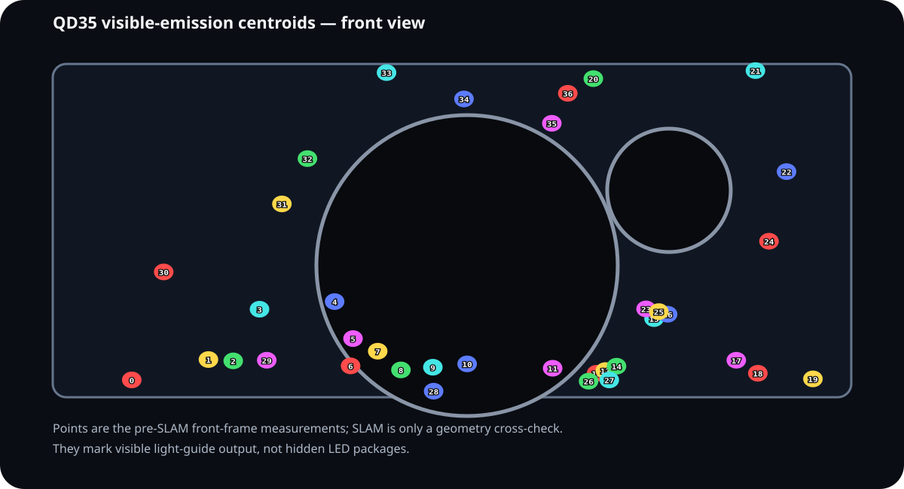

# QD35 lighting address map

The tested QD35 transmits and visibly responds to 37 addressable RGB nodes. Wire
addresses **0–19 traverse the lower light guide from left to right**; addresses
**20–36 traverse the ring around the mid-bass driver**. This map locates the
**visible emission centroid** of each wire address from a near-front view. It does
not claim to locate the hidden package: the transparent plastic routes a source
through an extended guide, and the apparent centroid moves with viewpoint.

A teardown of the domestic NEW-X shows a different 20-package lighting board. That
photograph is useful construction evidence, but it is not substituted for the
37-node serializer and 37 live responses measured on this international QD35.

Coordinates are percentages within the transparent lighting chamber. X increases left-to-right; Y increases top-to-bottom.

| Address | X % | Y % | Address | X % | Y % |
|---:|---:|---:|---:|---:|---:|
| 0 | 9.9 | 94.8 | 19 | 95.2 | 94.5 |
| 1 | 19.5 | 88.7 | 20 | 67.7 | 4.4 |
| 2 | 22.6 | 89.1 | 21 | 88.0 | 2.0 |
| 3 | 25.9 | 73.6 | 22 | 91.9 | 32.3 |
| 4 | 35.3 | 71.3 | 23 | 74.3 | 73.5 |
| 5 | 37.6 | 82.4 | 24 | 89.7 | 53.2 |
| 6 | 37.3 | 90.6 | 25 | 75.9 | 74.3 |
| 7 | 40.7 | 86.2 | 26 | 67.1 | 95.2 |
| 8 | 43.6 | 91.8 | 27 | 69.7 | 94.8 |
| 9 | 47.6 | 91.0 | 28 | 47.7 | 98.2 |
| 10 | 51.9 | 90.0 | 29 | 26.8 | 88.9 |
| 11 | 62.6 | 91.3 | 30 | 13.9 | 62.4 |
| 12 | 68.1 | 92.8 | 31 | 28.7 | 42.0 |
| 13 | 69.2 | 92.0 | 32 | 31.9 | 28.4 |
| 14 | 70.6 | 90.7 | 33 | 41.8 | 2.6 |
| 15 | 75.3 | 76.4 | 34 | 51.5 | 10.5 |
| 16 | 77.0 | 75.1 | 35 | 62.5 | 17.8 |
| 17 | 85.6 | 88.9 | 36 | 64.5 | 8.8 |
| 18 | 88.3 | 92.8 |  |  |  |

## Measurement

The mapper uses a 1.2-second blue start marker, a dim-white separator, addresses 0–36 for 250 ms each, and a 1.2-second yellow end marker. The uploaded recording contained four complete address loops. Blue starts were 365 video frames apart, which ruled out timing drift and wrap ambiguity. Each address used a repeating red/yellow/green/cyan/blue/magenta marker so adjacent positions could be distinguished even through optical diffusion.

The coordinates come from the first near-front loop. A 98-view structure-from-motion model from the moving-camera recording registered every view with 0.64-pixel mean reprojection error. It was useful for identifying occlusion and perspective limits, but not for pretending the extended light guides are point sources. A future 3D calibration should use isolated emitters on a dark background, a known scale or fiducials, and repeated fixed-angle arcs.
