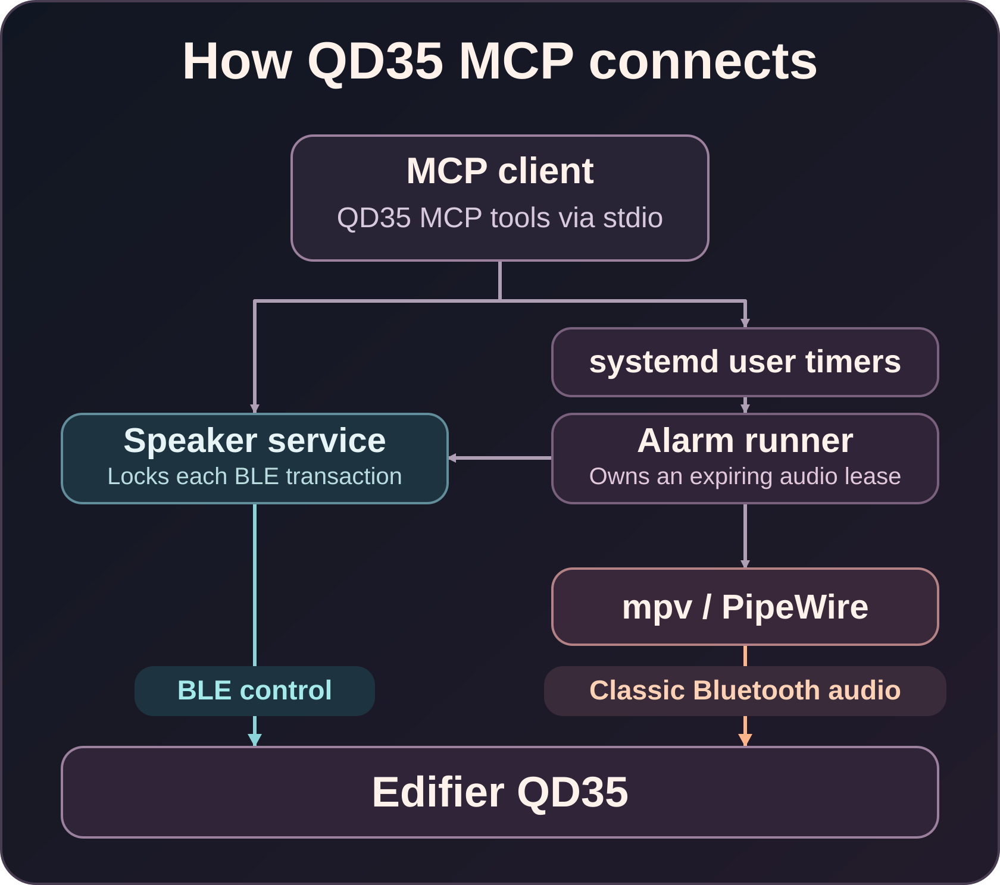

# Architecture and evidence

The package has two entry points into the speaker service. The MCP adapts agent requests
to semantic operations. The standalone alarm runner uses the same service from systemd
without starting or importing an MCP server.

[Editable diagram source](../assets/architecture.svg)

| Area | Where changes belong |
|---|---|
| Public MCP contract | `server.py` composes the server. `mcp_tools/` owns tool names, schemas, descriptions, error translation, and the static guide. |
| Speaker behavior | `service.py` owns writes, verification, and the shared transaction lock. `protocol.py` codecs work on bytes and have no hardware dependency. |
| Bluetooth and simulation | `factory.py` creates the service. `transport/` supplies the real Bleak transport and the deterministic fake. |
| Host coordination | `ownership.py` owns per-speaker file locks and expiring Classic audio leases. |
| Alarms | `alarm_schedule.py` owns calendar and ramp math. `alarms.py` stores plans and coordinates their lifecycle. `alarm_systemd.py` writes and operates user units. `alarm_runner.py` executes plans, with `audio_keepalive.py` handling Classic reconnects. |
| Animation and display | `animations.py` owns local generation and calibration data. `custom_lights.py` owns the pinned Edifier catalog. `display.py` and `firmware_patch.py` own the private display payloads and fixed-image patch. |

Keep authorization, target verification, and read–write–readback locking in the service.
Physical transactions also take an advisory per-address lock in the user's runtime directory.
The standalone runner holds a separate run lock so two alarms cannot ramp one speaker at once.
Tool wrappers should translate and validate arguments without implementing protocols. Keep
the persisted alarm schema and installed runner entry points compatible when moving code.
A reported acknowledgement and an independently observed state are separate outcomes.

## Where to look

- [MCP reference](mcp.md) documents the public tools and their limits.
- [Alarm operation](alarm-clock.md) and [display patch](display-firmware.md) document setup.
- [App inventory](app-features.md) maps documented app features to available operations.
- [Protocol](protocol.md) records byte layouts and command evidence.
- [Hardware validation](hardware-validation.md) records observations on the physical speaker.
- [Firmware analysis](firmware-analysis.md) and [address map](address-map.md) preserve research
  and measurement assumptions separately from the public API.

## Remaining boundaries

- **External controllers.** The host locks coordinate QD35 MCP processes of the same Linux
  user. The phone, other user accounts, and bare Bluetooth clients can still compete for the
  connection. Manual MCP changes can land between alarm steps. A long-term single-owner
  daemon could additionally retain one BLE session and arbitrate manual changes during a run.
- **Verification scope.** Simulator tests prove the software contract. A stock query can
  report settings, but display requests and installed animation bytes lack independent device
  readback. Keep physical measurements in the hardware record.
- **Next decomposition.** `service.py` still owns several device families of operations.
  Animation upload is a good candidate for a separate orchestration module once it can
  keep the same target, shared lock, and bounded recovery across the entire transfer.
